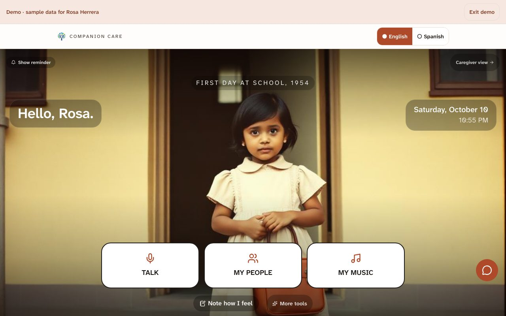
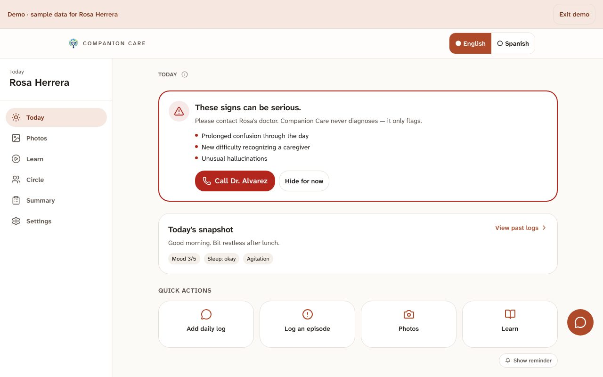
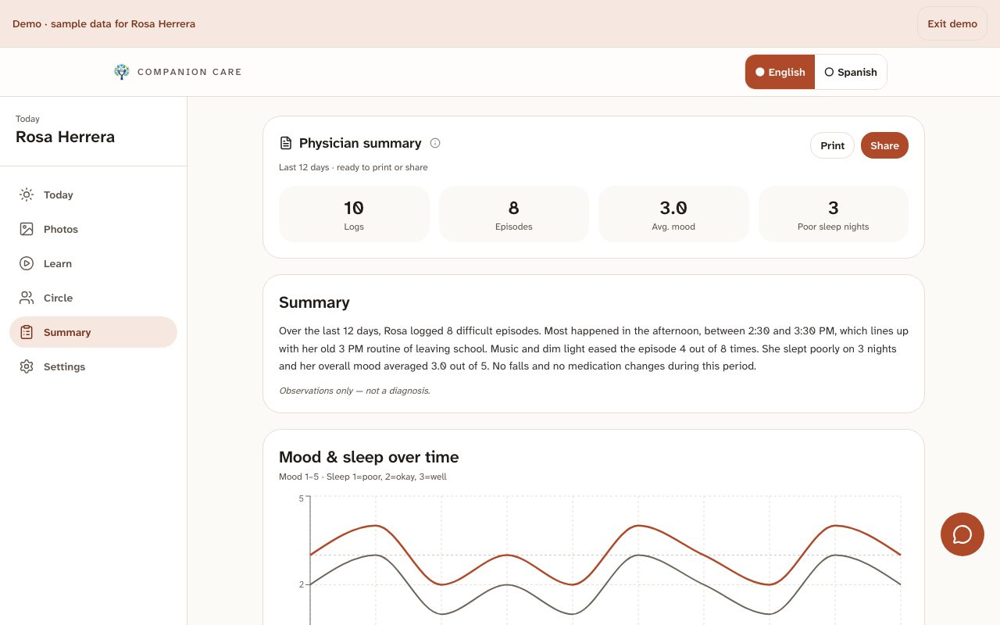
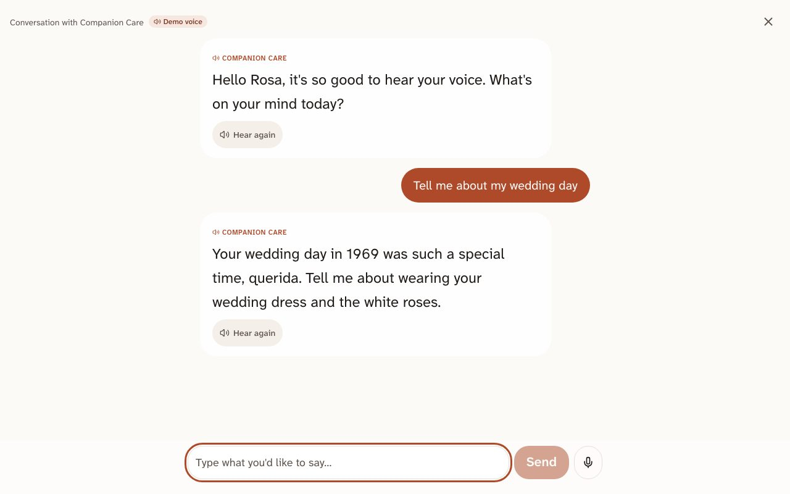
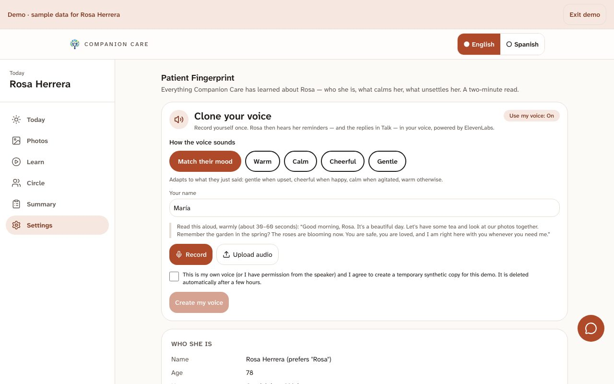
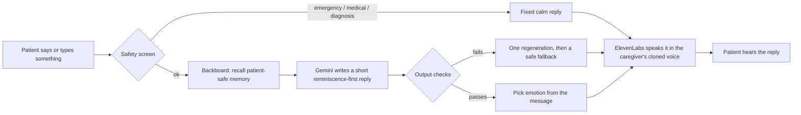

# Companion Care

**A calm AI companion for people living with early-to-mid stage dementia, and for the families and doctors who care for them.**

Built for **CodeRED Orion 2026** (University of Houston). It grew out of research done in the SHERP 2026 summer program (Humana Institute, University of Houston).

**Live demo (no sign-up): [companioncare.chandrarupdaka.work](https://companioncare.chandrarupdaka.work/demo)**



## Why

Dementia care is not short of awareness. It is short of tools that work after the diagnosis. The figures below come from the project's research deck, which cites the Alzheimer's Association 2026 Facts & Figures:

- About **7.4 million** Americans 65 and older live with Alzheimer's dementia.
- More than **12 million** unpaid family caregivers give the day-to-day care.
- Behaviours such as late-afternoon agitation are unmet needs that families struggle to read, and they are a leading driver of caregiver burnout.
- Families usually leave the clinic with a pamphlet, and most existing apps are static libraries of articles or one-way trackers for a single person.

Interviews with caregivers pointed to three needs: clear guidance they can understand, a simple log to see change over time, and engagement through music and personal memories.

## What it does

One app, three surfaces, one shared record.

| Surface | For | What it gives them |
| --- | --- | --- |
| **Patient** | The person with dementia | A quiet, photo-led screen with three large buttons: **Talk**, **My people**, **My music**. Reminders and replies are spoken in the voice of someone they trust. |
| **Caregiver** | Family and carers | A 60-second log (by voice or tap), a "trigger fingerprint" that learns what unsettles and what calms this person, short trainings, safety flags, care hand-off, and an Ask assistant. |
| **Physician** | The doctor | A one-tap, 90-second summary of the time between visits: counts and dates, never a diagnosis. |

### The features we are proudest of

- **The caregiver's own voice.** A caregiver records their voice once; ElevenLabs clones it. Reminders and conversation replies reach the patient in that familiar voice. You can try this in the demo: open the caregiver view, go to Settings, and clone your own voice.
- **Emotion that fits the moment.** The voice is spoken with an emotion (warm, calm, cheerful, gentle). In "match their mood" mode, the reply adapts to what the patient just said: gentle when they are upset or lost, cheerful when they talk about something they love, calm when they are agitated.
- **Reminiscence first.** Patient replies are written to bring back happy memories, not to answer questions that could confuse or hurt. They never quiz ("do you remember...?"), correct, or raise death or diagnosis.
- **A memory of the person.** Their story (family, work, music, favourite places) is kept in a Backboard memory. Only a patient-safe version is ever used in the patient chat; caregiver-only notes stay separate.
- **Photos and music from their life.** Family photos and music from their youth, with YouTube and short song previews.
- **Bilingual.** Full English and Spanish interface, replies and voice.
- **Safety built in.** Medication, driving and prognosis questions are routed to the doctor. Emergency language gets a fixed, calm reply. Factual answers in the caregiver Ask cite trusted sources such as the Alzheimer's Association and the NIA.

## Our approach

1. **Accompany, don't monitor.** Most dementia technology treats the patient as someone to watch. We build for the person first, then the caregiver, then the doctor.
2. **Calm by design.** Agitation is the enemy, so the patient screen shows one cherished photo and three big buttons, and nothing else.
3. **Counts, never conclusions.** The system counts what happened, finds what repeats, and shows it. It never diagnoses. The doctor interprets.
4. **A demo that cannot fail.** Every call to an outside service has a time limit and a fallback (pre-written on-topic replies with pre-recorded audio), so the live demo always works even if Gemini, ElevenLabs or the network does not.

### Design for dementia

The interface follows published guidance for people with dementia and low vision ([Alzheimer's Society](https://www.alzheimers.org.uk/blog/how-design-website-someone-affected-dementia), [AbilityNet](https://abilitynet.org.uk/factsheets/designing-dementia)):

- One colour on a warm near-white base: terracotta, used only for the main action, the active tab and focus. No blue or purple, no gradients, no shadows, no patterns behind text.
- One sans-serif family built for readability, **Atkinson Hyperlegible Next**, at large sizes.
- Strong contrast: body text about 16:1, buttons at least 5:1, and 44 px or larger tap targets (88 px or larger in patient mode).
- Meaning is never carried by colour alone. Icons and words always come with it.
- A warm dark **evening mode** in the signed-in app that switches on after 7 PM.

| | |
| --- | --- |
|  |  |
|  |  |

## How it works



**Every reply passes through guardrails** (`src/lib/guardrails.ts`): input screens for emergencies, diagnosis, medication and "are you a robot"; a hard-rule system prompt; output checks for death, diagnosis, correction, quizzing, AI mentions and cut-off text; and a calm fallback if two attempts fail.

**Memory is split in two.** A *life* memory (patient-safe) is the only one the patient chat may read. A *care* memory (caregiver-only) holds observations. The life memory rebuilds automatically when the profile changes.

**Data is private by design.** Each household sees only its own data through Postgres row-level security. `npm run test:isolation` proves it across two households.

## Tech stack and sponsor tools

| Tool | What we use it for |
| --- | --- |
| **Google Gemini** | Reminiscence-first replies, with a model chain, time limits and quality checks |
| **ElevenLabs** | Voice cloning of the caregiver, and speech with emotion (Eleven v3 audio tags, falling back to multilingual v2) |
| **Backboard** | Persistent patient memory: a patient-safe "life" memory and a caregiver-only "care" memory |
| **Tiger Data** | PostgreSQL with TimescaleDB. Logs, cue events and music sessions are hypertables |
| **Vultr** | Hosting on a Cloud Compute server behind Caddy (automatic HTTPS) |
| TanStack Start, React 19, Vite, Tailwind 4 | App framework, server functions, styling |
| Playwright | Screen-size, contrast and regression audits |

The app is a TanStack Start (React 19, TypeScript) app. A small supabase-js-shaped query layer in `src/integrations/db` runs each request as a limited Postgres role so row-level-security policies stay in force.

## Run it locally

```bash
nvm use                       # Node 22
npm install
cp .env.example .env          # fill in the keys below
npm run db:migrate            # creates the schema on your database
npm run dev                   # http://localhost:8080
```

| Variable | What it is |
| --- | --- |
| `DATABASE_URL` | PostgreSQL connection string (Tiger Data, or local Docker: see `.env.example`) |
| `AUTH_JWT_SECRET` | Any long random string (`openssl rand -hex 32`) |
| `GEMINI_API_KEY` | Google AI Studio key |
| `ELEVENLABS_API_KEY`, `ELEVENLABS_VOICE_ID` | ElevenLabs key and the default demo voice |
| `BACKBOARD_API_KEY` | Backboard key |

The public demo at `/demo` needs no sign-in. Real accounts use the sign-in page; use `/admin` once to load sample data.

### Useful scripts

```bash
npm run build && npm run start     # production Node server
npm run typecheck                  # TypeScript
npm run eval:guardrails            # tough English and Spanish prompts against the guardrails
npm run test:isolation             # households cannot see each other's data
npm run demo:audio                 # regenerate the recorded fallback audio
node scripts/demo-sweep.mjs        # visit every demo screen at three sizes, in both languages
node scripts/design-audit.mjs      # screenshots plus contrast and overflow checks
```

### Deploy

`scripts/deploy.sh` builds, copies the build to the server and restarts it. `deploy/` holds the systemd unit and the one-time server setup (Node 22, Caddy, firewall).

```bash
DEPLOY_HOST=root@<server-ip> npm run deploy
```

## Responsible use and status

Companion Care is **decision support, not a medical device**. It surfaces counts and observations and routes clinical judgement to a human. It does not diagnose, dose or treat.

This is a **student MVP** built toward HIPAA-style safeguards (encryption in transit, role-based access, per-household isolation, an edit-lock on records). It is **not certified**, and full compliance (signed vendor agreements, a formal security audit) is a milestone before any pilot with real patients. **The demo uses synthetic data only. Please do not enter real health information.**

## Roadmap

From our research plan: a 50-family pilot in Houston to generate evidence, then a Houston Dementia Living Lab, then partnerships with health plans, scaling across Texas and nationally on proven outcomes.

Next in the product: caregiver Ask answers drawn from the family's own logs, and a PIN-protected exit from patient mode.

## Team

Chandra Daka and Ashrith Vadde, University of Houston, Cullen College of Engineering.

The earlier research project (SHERP 2026, Humana Institute) also involved Roberto de Freitas, Susan Guajardo, Isaiah Olumeko, Saba Yazdekhasti, Olutobi S and Maryam Vasefi.
